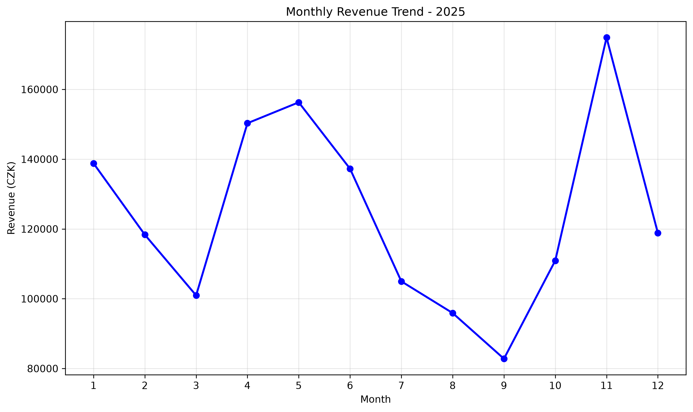
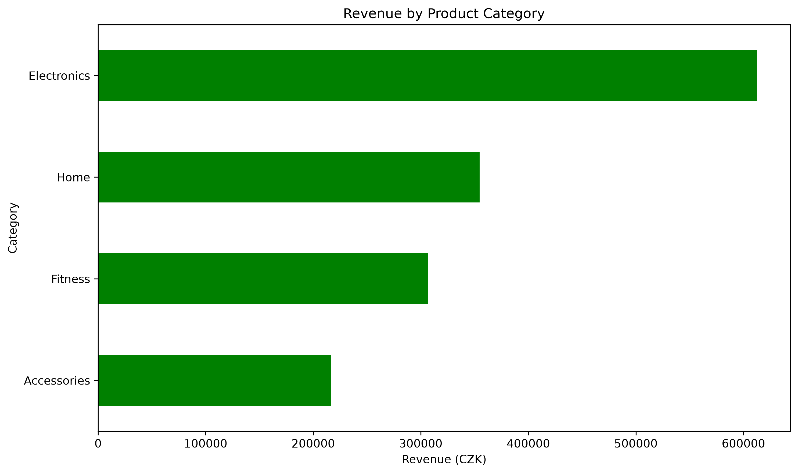
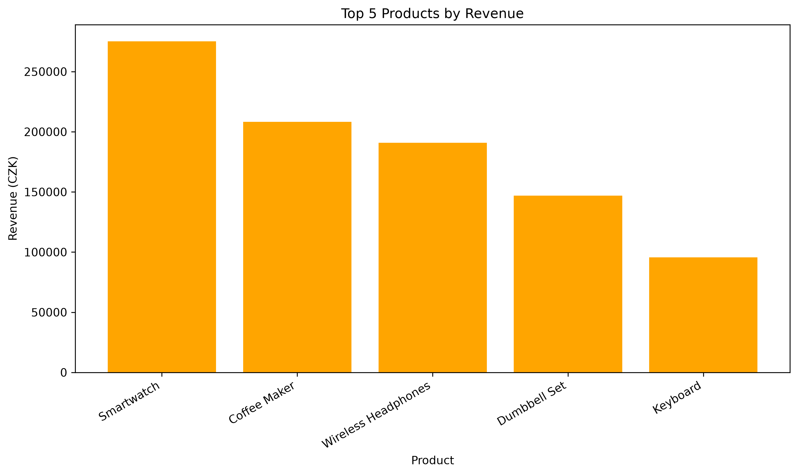
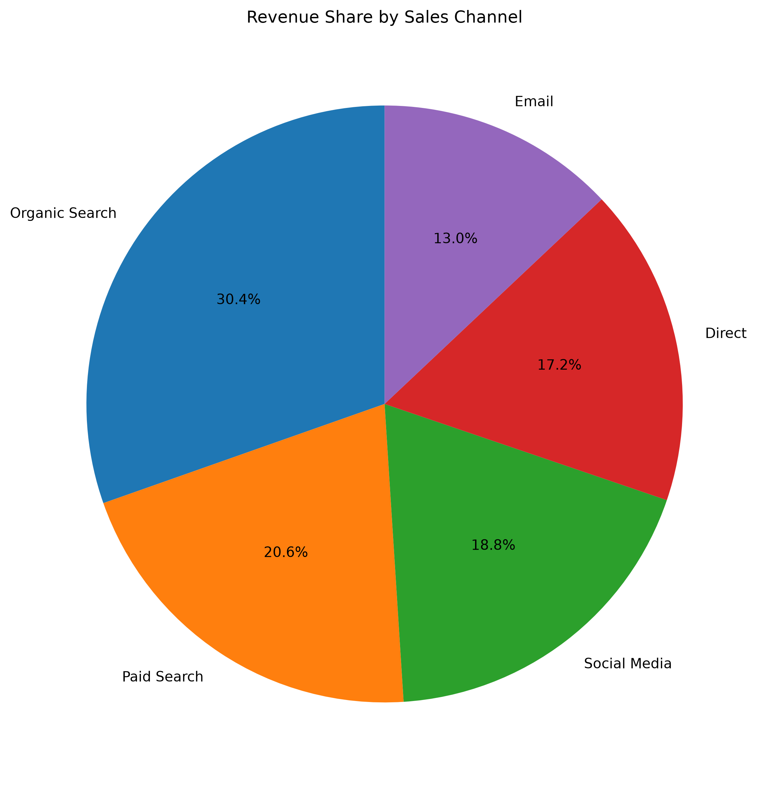
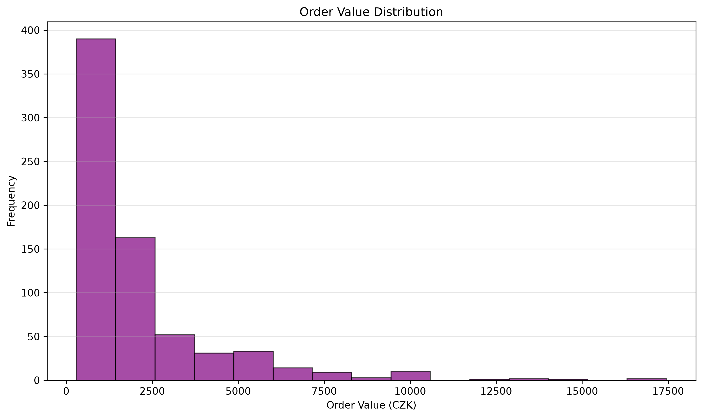

# E-commerce Sales Analysis with Python

## Project Overview
This portfolio project analyzes **800 synthetic e-commerce orders from 2025** in the Czech Republic. The analysis focuses on sales performance, profitability, product categories, regional performance, marketing channels, and order statuses.

**Tech stack:** Python, Pandas, NumPy, Matplotlib.

> **Data disclaimer:** This is a synthetic educational dataset, not real company sales data.

## Key Performance Indicators

| Metric | Result |
|---|---:|
| Total revenue (completed orders) | 1,490,261.40 CZK |
| Completed orders | 711 |
| Average order value | 2,096.01 CZK |
| Units sold | 1,275 |
| Gross profit | 709,921.40 CZK |
| Gross profit margin | 47.64% |
| Completion rate | 88.88% |
| Cancellation rate | 6.12% |
| Return rate | 5.00% |

## Key Findings

- **Electronics** was the highest-revenue category, generating **612,788.10 CZK**.
- **Smartwatch** was the top product by revenue (**275,215.60 CZK**).
- **Organic Search** was the highest-revenue sales channel (**452,900.30 CZK**).
- **Prague** generated the most regional revenue (**393,500.10 CZK**).
- **November** had the highest monthly revenue (**174,857.30 CZK**).
- The dataset contained **0 missing values, 0 duplicate rows, and 0 duplicate order IDs**. Price, quantity, cost, discount, and date validation found no invalid entries.

## Methodology

1. Loaded and explored the CSV dataset.
2. Checked missing values, duplicates, date parsing, and numeric ranges.
3. Included only `Completed` orders in realized revenue and gross profit calculations; `Cancelled` and `Returned` orders were analyzed separately as order-status rates.
4. Calculated discounted revenue per order as `unit_price_czk * quantity * (1 - discount_pct / 100)`.
5. Calculated gross profit as discounted revenue minus `unit_cost_czk * quantity`. This **does not** include overhead, shipping, taxes, or other operating costs.
6. Aggregated results by category, product, region, channel, and month.
7. Created and exported charts using Matplotlib.

## Visualizations

### Monthly Revenue Trend


### Revenue by Category


### Top 5 Products


### Revenue Share by Sales Channel


### Order Value Distribution


## Project Structure

```text
ecommerce-sales-analysis-python/
├── data/
│   └── ecommerce_sales_2025.csv
├── charts/
│   ├── monthly_revenue.png
│   ├── category_revenue.png
│   ├── top_products.png
│   ├── sales_channels.png
│   └── order_distribution.png
├── sales_analysis.py
├── README.md
├── requirements.txt
└── .gitignore
```

## How to Run

1. Clone the repository and open it in PyCharm or a terminal.
2. Create a virtual environment and install dependencies:
   ```bash
   python3 -m venv .venv
   source .venv/bin/activate
   pip install -r requirements.txt
   ```
3. In `sales_analysis.py`, use a **relative CSV path**:
   ```python
   df = pd.read_csv("data/ecommerce_sales_2025.csv")
   ```
4. Run from the repository root:
   ```bash
   python sales_analysis.py
   ```
5. The analysis prints KPIs and saves five PNG charts in `charts/`.

## Limitations

This project uses synthetic data and descriptive analysis. Revenue excludes cancelled and returned orders. Gross profit excludes operational costs and should not be interpreted as net profit. The dataset uses one row per order ID.
